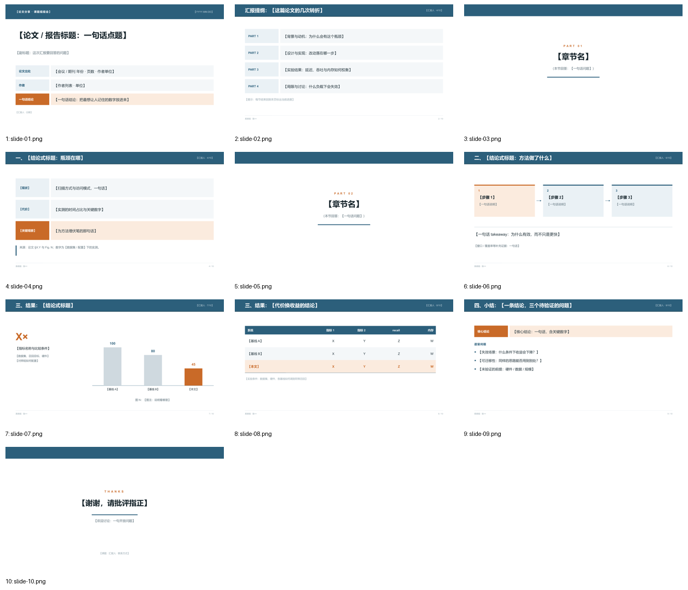

# Band Grid · 中文论文分享 / 文献综述

> 蒸馏自南方科技大学论文分享 Beamer 模板公开预览（`yhbcode000/sustech-slides-template`，`main_template.pdf`）。只保留风格，不复制校徽、模板源码或内容。来源、色值与逐张截图见 [`refs/ATTRIBUTION.md`](refs/ATTRIBUTION.md)。

**适合**：中文论文精读、文献综述、组会里需要逐条拆论点的长汇报。
**不适合**：需要大留白与极简表达的英文 conference talk。

## 视觉签名

每页顶部一条 **0.72in 满版蓝色页眉带**（左标题 / 右汇报人 · 页码），下沿 0.035in 深蓝细线；正文的基本单元是**横向标签带**——左侧 2.05in 定宽标签块 + 右侧内容带；普通档蓝 / 浅蓝，**重点档整条换成橙 / 浅橙**；章节页是白底居中的 `PART NN + 标题 + 一句括号提示 + 短蓝线`。

标签带比「卡片」更适合中文长句：标签与内容在同一水平线上，视线不用折返。

## 字体与基础模板

| 角色 | 首选 | 开源替代 |
|---|---|---|
| 西文 | Arial / Helvetica | Arimo |
| 中文 | Microsoft YaHei / PingFang SC / Source Han Sans SC | Noto Sans SC |
| 等宽 | Consolas / Menlo | JetBrains Mono |

全部无衬线，粗体只给标题、标签块与本文那一行。

- 检查本机字体：`python scripts/check_fonts.py bandgrid`；来源、授权与安全字体组见 [fonts.md](../../references/fonts.md)。
- 基础模板：[template.pptx](template.pptx)（每页是带占位说明的原型，演讲备注写明这页该放什么），预览：

## 字号（pt，16:9）

| token | 值 | 用在哪 |
|---|---:|---|
| `cover` | 34 | 封面中文标题 |
| `bigNumber` | 44 | 结果页唯一大数字 |
| `section` | 34 | PART 页居中标题 |
| `title` | 22 | 页眉带标题（白字） |
| `body` | 16 | 标签带正文 |
| `subtitle` | 15 | 封面副标题 |
| `small` | 13 | 说明 |
| `chip` | 13 | 标签块文字（粗） |
| `caption` | 12 | 居中图注 |
| `source` | 9.5 | 出处 |
| `footer` | 8.5 | 页脚 |

## 配色

| token | 值 | 语义 |
|---|---|---|
| `primary` | `#2C5F7B` | 页眉带、PART 序号、表头、自绘图主模块 |
| `primaryDark` | `#1F4759` | 页眉下沿细线 |
| `primaryLight` | `#EAF1F5` | 标签块底色、表格隔行、非重点档位 |
| `accent` | `#C96A28` | 关键环节标签、本文方法、唯一强调数字 |
| `accentLight` | `#FBEBDE` | 重点档位底色（与 accent 成对出现） |
| `text` / `body` | `#16242B` / `#22333B` | 标题 / 正文 |
| `ghost` / `rule` / `frame` | `#CFD9DF` / `#D3DDE3` / `#F4F7F9` | 灰蓝柱 / 细线 / 承托框 |
| `onPrimary` / `onPrimaryMuted` | `#FFFFFF` / `#C2D3DC` | 页眉带文字 |

来源实测：SUSTech p1 `#2C5F7B`(15.3%)；p2 `#2C5F7B`(7.6%)、`#E67D21`(0.9%)。`accent` 是 `#E67D21` 在白底上的**对比度压暗版**——原色在宽屏上做细条与小字偏亮，不是照抄。

## 栅格

| token | 值 (in) | 说明 |
|---|---:|---|
| `marginX` | 0.62 | 窄边距，页眉带通栏 |
| `barH` | 0.72 | 页眉带高度（封面 0.9） |
| `chipW` | 2.05 | 标签块定宽 |
| `bandGap` | 0.16 | 标签带间距 |
| `contentY` / `contentBottom` | 1.50 / 6.72 | 内容安全区 |
| `footerY` | 6.98 | 页脚细线在其上 0.20 |

`band()` 的高度按文字估算行数自适应（最小 0.7in），避免中文两行被挤；`bands()` 会把可用高度平均分配给 2–3 条带。

## 页面原型（`prototypes.js`）

| type | 用途 | 关键字段 |
|---|---|---|
| `cover` | 蓝带 + 标题 + 三条信息带（含橙色结论带） | `kicker, date, title, subtitle, venue, authors, takeaway, foot` |
| `outline` | PART 1–4 四条带 + 一句提示 | `items[{label,text}], hint` |
| `part` | 白底居中分区页 | `index, title, note` |
| `bands` | 2–3 条标签带，最后一条重点档 | `rows[{label,text,accent}], aside` |
| `method` | 三步横向带 + 箭头 + takeaway | `stages[{t,d}], hot, takeaway, aside` |
| `result` | 大数字 + 灰蓝 / 橙柱 | `big, bigLabel, bigNote, data[], caption` |
| `table` | 满填蓝表头 + 隔行 + 本文淡橙行 | `cols, widths, rows[{cells,ours}], tableNote` |
| `summary` | 橙色核心结论带 + 三个遗留问题 | `conclusion, questions[]` |
| `thanks` | 白底致谢 + 蓝带 | `title, line, contact` |

工具函数：`head / foot / band / bars`。

## 推荐页序（10 页）

`cover → outline → part① → bands(动机) → part② → method → result → table → summary → thanks`

节奏靠**页眉带 + PART 分区页**制造。长汇报可以在每个 Part 结束回到 `outline` 标进度；`hint` 字段就是为此留的。

## 硬约束

1. 每页都要有满版页眉带；**页眉带是结构，不计入强调色预算**。全稿允许第二种彩色（橙），但只给重点档与本文方案。
2. 一页最多 **3 条**标签带，每条中文 ≤ 32 字；最后一条用 `accent` 收口，写「关键观察」而不是重复前文。
3. 一页最多 **3 条**要点；超一条就拆页，不要缩字号。
4. 章节页只有 `PART NN`、标题、一句括号提示、一条短蓝线，共 4 个元素，不加装饰。
5. 图表：无网格线、无图例框、无 3D；对照灰蓝 `ghost`，本文 `accent`；数值直接标在柱上；图注居中「图 N：说明看哪里」。
6. 表格：满填蓝表头白字、隔行浅底、无竖线、数字列右对齐；本文行淡橙 `accentLight` + 橙字加粗；表下写实验条件与基线调参方式。
7. 数字页在页脚上方写「来源：论文 §X.Y 与 Fig. N；数字为【数据集 / 配置】下的实测」。
8. 去掉原件的校徽与底栏口号；封面「一句话结论」带必须放最想让人记住的数字。

## 文件

| 文件 | 说明 |
|---|---|
| `tokens.json` | `loadTokens('bandgrid')` 读取 |
| `prototypes.js` | 10 个原型 + 工具函数，PPTX / SVG 双画布可用 |
| `template.pptx` | 10 页填空模板，演讲备注写每页的内容契约 |
| `samples/` | 10 页样稿 PNG（`npm run samples` 生成，虚构占位论文） |
| `refs/` | 4 张来源截图 + 出处 |

## 验证

`check_deck.py` → `pass` / 0 errors；`lint_style.py`（以本套 token 重载）→ 0 errors / 0 warnings；`npm run samples` 同时产出每页 SVG 预览；渲染后逐页视觉迭代 8 轮（[`samples/overview.png`](samples/overview.png)）。
