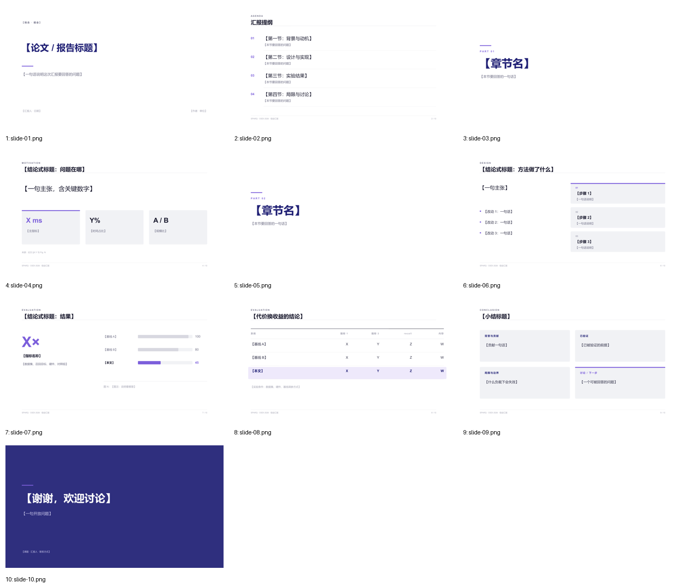

# Folio · 编辑式留白（Indigo）

> 蒸馏自 `sci-brain-slides 0.1.0` academic 主题与 `starter.pdf`（Typst Universe，2026-09 发布）；交叉验证 Neversink（2024–2026）与 ACL 2025 示例。只保留风格，不复制内容。来源、色值与截图见 [`refs/ATTRIBUTION.md`](refs/ATTRIBUTION.md)。

**适合**：论文精读、偏理论/方法的工作、想让观众「读」而不是「看」的汇报；英文与中文都成立。
**不适合**：需要密集表格、多图并排或强导航的答辩。

## 视觉签名

白底 + **超大留白**（正文只占中部 50–60% 高度）+ **0.7 in 紫色短横线**作为章节标记 + 浅灰无边框卡片 + **满版靛蓝结论页**。全稿没有任何页眉带、没有装饰框、没有阴影。层级全靠字号、字重和位置，不靠色块。

和 Graphite 的区别：Graphite 靠「一条通栏细线 + 明暗交替」，Folio 靠「短横线 + 留白」，且只有最后一页是深色。

## 字体与基础模板

西文 Arial / Helvetica（开源 Arimo），中文 Microsoft YaHei / PingFang SC（开源 Noto Sans SC），等宽 Consolas。

| token | 值 (pt) | 用在哪 |
|---|---:|---|
| `cover` | 40 | 封面标题 |
| `bigNumber` | 64 | 结果页唯一大数字 |
| `section` | 48 | 章节页单个大词 |
| `title` | 24 | 内容页标题 |
| `body` | 17 | 正文、主张句 |
| `subtitle` | 16 | 封面副标题 |
| `cardTitle` | 15 | 卡片标题 |
| `small` / `caption` / `kicker` / `footer` | 13 / 11 / 10 / 8.5 | 说明 / 图注 / 页首标签 / 页脚 |

来源实测 `sci-starter.pdf`：正文 15.4pt、标题 26.4pt、大标题 39.6pt（Typst 逻辑页），本套按比例放大到 16:9 宽屏，层级比例不变。

- 检查本机字体：`python scripts/check_fonts.py folio`；来源、授权与安全字体组见 [fonts.md](../../references/fonts.md)。
- 基础模板：[template.pptx](template.pptx)（每页是带占位说明的原型，演讲备注写明这页该放什么），预览：

## 配色（实测自 `sci-gallery.pdf` p4 与 `sci-starter.pdf` p6）

| token | 值 | 语义 |
|---|---|---|
| `primary` | `#2F2F7E` | 靛蓝：标题、章节大词、满版结论页底 |
| `primaryDark` | `#222276` | 封面标题（starter p1 实测） |
| `accent` | `#7C5FDB` | 薰衣草紫：**全稿唯一强调色**，短横线、hero 数字、当前项 |
| `frame` | `#F1F2F5` | 浅灰卡片承托面（starter p5 实测 `#F1F2F5`） |
| `rule` / `ghost` | `#E4E4E8` / `#D8D8E0` | 发丝线 / 非重点条形 |
| `ink` / `body` / `muted` | `#1B1B2F` / `#33334A` / `#6E6E85` | 标题 / 正文 / 说明 |
| `accentSoft` | `#EEE9FB` | 本文行浅紫底 |

## 栅格

| token | 值 (in) | 说明 |
|---|---:|---|
| `marginX` | 1.00 | 宽边距，比 graphite / bandgrid 更"书页" |
| `kickerY` / `ruleY` | 0.62 / 1.32 | 页首小标签 / 标题下通栏细线 |
| `contentY` / `contentBottom` | 1.78 / 6.66 | 内容安全区 |
| `footerY` | 7.02 | 页脚细线在其上 0.2 |
| `gutter` | 0.42 | 卡片间距 |

## 页面原型（`prototypes.js`）

| type | 用途 | 关键字段 |
|---|---|---|
| `cover` | 白底大留白封面 | `kicker, title, subtitle, meta, authors` |
| `outline` | 编号提纲 + 发丝线 | `items[{t,note}]` |
| `section` | 白底章节页（短横线 + PART + 大词） | `index, title, note` |
| `claim` | Hero：一句主张 + 3 张数字卡 | `claim, claimNote, metrics[{v,k,hot}], source` |
| `method` | Spread：左解释 / 右三张堆叠卡 | `claim, bullets[], stages[{t,d}], hot` |
| `result` | 大数字 + **横向**条形图 | `big, bigLabel, bigNote, data[], caption` |
| `table` | 细横线表，本文行浅紫底 | `cols, widths, rows[{cells,ours}], tableNote` |
| `summary` | 2×2 卡片网格 | `cards[{label,text}]` |
| `thanks` | **满版靛蓝**致谢 | `title, line, contact` |

工具：`head / foot / card / hbars`。

## 推荐页序（10 页）

`cover → outline → section① → claim → section② → method → result → table → summary → thanks`

节奏：前 9 页全白，仅第 10 页满版靛蓝收口。**不要中途插入深色页**，否则这个"最后一击"会失效。

## 硬约束

1. 正文页内容只占中部 50–60% 高度；上下留白是设计，不是没排满，不要填色块补空。
2. 全稿只有一个强调色 `#7C5FDB`；一页最多一个紫色关键词（≤6 汉字）。
3. 短横线固定 0.7 × 0.045 in，只出现在章节页与封面标题下；不用图标、不用圆点导航。
4. 卡片：浅灰 `frame` 填充、圆角 ≤0.06 in、无阴影；一页最多 4 张；只有当前项加紫色顶条。
5. 图表：横向条形、无网格、无图例框、数值直接标在条尾；对照 `ghost`，本文 `accent`。
6. 表格：只保留横线，本文行浅紫底 + 加粗，数字列右对齐；表下写实验条件。
7. 数字页必须带 `source`；图注「图 N：说明看哪里」编号与正文引用一致。
8. 一页最多 4 条要点，每条中文 ≤28 字；宁可拆页也不缩字号。

## 文件与验证

`tokens.json`（`loadTokens('folio')`）、`prototypes.js`（9 原型，PPTX/SVG 双画布可用）、`template.pptx`（10 页填空 + 演讲备注写内容契约）、`samples/`（`npm run samples` 生成）、`refs/`、`template-preview/`。

`check_deck.py` → `pass`；以本套 token 重载 `lint_style` → 0 errors / 0 warnings；`npm run samples` 同时产出每页 SVG 预览；渲染后逐页视觉迭代 2 轮（[`samples/overview.png`](samples/overview.png)）。
