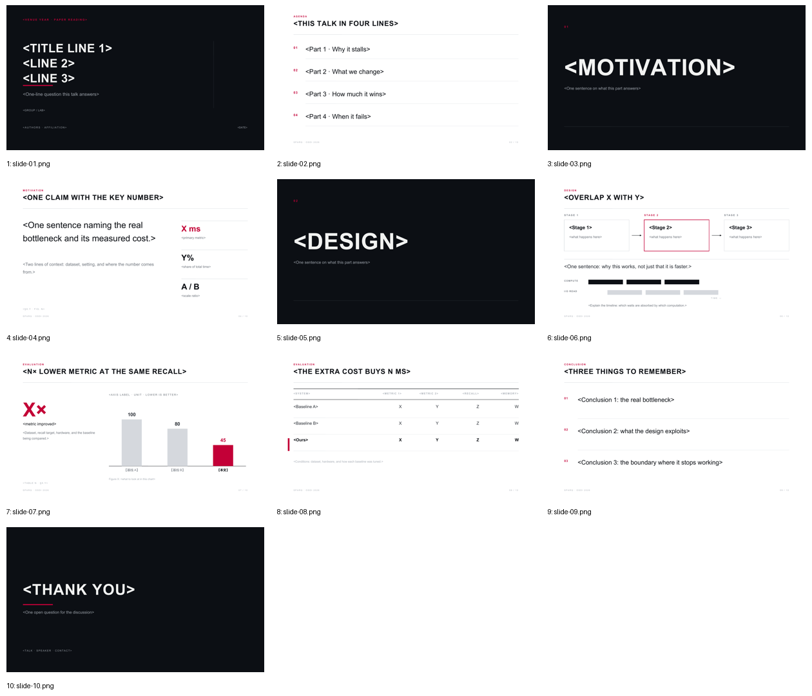

# Graphite · 高对比系统讲座

> 蒸馏自 CMU 15-445 Database Systems（Andy Pavlo, Fall 2024）公开课件。只保留风格，不复制内容或图件。来源、色值与逐张截图见 [`refs/ATTRIBUTION.md`](refs/ATTRIBUTION.md)。

**适合**：英文组会、系统 / 体系结构 / 数据库论文解读、会议 talk；也适合中英混排的国内组会。
**不适合**：需要密集表格或公式推导的页、需要校徽与正式抬头页的答辩。

## 视觉签名

深色满版封面 / 章节 / 致谢（约占全稿 30%），内容页纯白底，**唯一的装饰是一条通栏 hairline**；页首是 `红色 kicker → 全大写粗标题 → 细线` 三级；全稿只有一个强调色 `#C30037`，其余全在灰阶里。正文极稀疏，一页只讲一件事。

## 字体与基础模板

| 角色 | 首选 | 开源替代（`PAPER_PPT_FONTS=open`） |
|---|---|---|
| 西文 | Arial / Helvetica | Arimo |
| 中文 | Microsoft YaHei / PingFang SC / Source Han Sans SC | Noto Sans SC |
| 等宽 | Consolas / Menlo | JetBrains Mono |

原件封面用的是衬线粗体，本预设换成 Arial Bold：**保留的是字号对比（44 : 26 : 9）与字距，不是字面**。原因是仓库预设均为无衬线优先，中文衬线在放映机上不可用。

- 检查本机字体：`python scripts/check_fonts.py graphite`；来源、授权与安全字体组见 [fonts.md](../../references/fonts.md)。
- 基础模板：[template.pptx](template.pptx)（每页是带占位说明的原型，演讲备注写明这页该放什么），预览：

## 字号（pt，16:9 / 13.333 × 7.5 in）

| token | 值 | 用在哪 |
|---|---:|---|
| `cover` | 44 | 封面标题，按行宽可自动降到 32 |
| `section` | 84 | 章节页单个大词 |
| `bigNumber` | 72 | 结果页唯一大数字 |
| `title` | 26 | 内容页全大写标题 + 1.1pt 字距 |
| `body` | 21 | 主张句 / 要点行；**正文不低于 19** |
| `subtitle` | 17 | 封面副标题 |
| `small` | 13 | 说明、图内注释 |
| `caption` | 11 | 图注 |
| `source` | 9 | 出处行 |
| `kicker` | 9 | 页首红色标签 + 2.2pt 字距 |
| `footer` | 7.5 | 页脚 + 1.6pt 字距 |

## 配色

| token | 值 | 语义 |
|---|---|---|
| `ink` / `primary` | `#0C0F14` | 深色页满版底、正文标题 |
| `text` / `body` | `#14181E` / `#2A2F36` | 正文 |
| `muted` / `faint` | `#6E747C` / `#A8AEB6` | 说明 / 页脚 |
| `ghost` / `rule` / `tint` | `#D5D8DD` / `#CFD3D9` / `#F4F4F6` | 灰阶柱 / 细线 / 底纹 |
| `accent` | `#C30037` | **全稿唯一强调色**：kicker、强调数字、当前阶段、本文方案 |
| `onDark` / `onDarkMuted` | `#F1F2F1` / `#9AA0A8` | 深色页文字 |
| `hairDark` | `#2A2F36` | 深色页分隔线 |

来源实测：CMU p1 `#C30037`(2.3%)、`#0D1015`(2.0%)、`#0C0F14`(1.1%)；p8 大面积 `#F4F4F4` 系浅灰。

## 栅格

| token | 值 (in) | 说明 |
|---|---:|---|
| `marginX` | 0.85 | 宽边距，视觉中心略偏左 |
| `kickerY` / `titleY` / `titleH` | 0.50 / 0.70 / 0.62 | 页首三级 |
| `ruleY` | 1.52 | 通栏 hairline 固定位置 |
| `contentY` / `contentBottom` | 1.86 / 6.70 | 内容安全区 |
| `footerY` | 7.02 | 页脚；出处行在其上 0.38 |

深色调页（封面 / 章节 / 致谢）不用页眉三级，改为左侧竖线或短红条收口。

## 页面原型（`prototypes.js`）

| type | 用途 | 关键字段 |
|---|---|---|
| `cover` | 深色封面 | `kicker, title(\n 分行), subtitle, authors, affil, meta` |
| `outline` | 编号提纲，无项目符号 | `items[]` |
| `section` | 深色章节页 | `index, word, line` |
| `statement` | 一句主张 + 右侧 3 个数字 | `claim, claimNote, metrics[{v,k,hot}], source` |
| `method` | 三阶段方框 + 箭头 + 时间重叠条 | `stages[{t,d}], hot, takeaway, timeNote` |
| `result` | 大数字 + 灰阶柱状图 | `big, bigLabel, bigNote, axis, data[{label,value,ours}], caption` |
| `table` | booktabs 表格 | `cols, widths, rows[{cells,ours}], tableNote` |
| `summary` | 三条结论，发丝线分隔 | `items[]` |
| `thanks` | 深色致谢 | `title, line, contact` |

另有工具函数 `head / foot / rows / bars`，可被自由绘制的页面复用。

## 推荐页序（10 页）

`cover → outline → section① → statement → section② → method → result → table → summary → thanks`

节奏靠**明暗交替**制造：1 / 3 / 5 / 10 是深色页。若删掉章节页，整份 deck 会失去节奏，建议改用 `outline` 上标进度而不是直接取消。

## 硬约束

1. 一页最多 **3 条**要点；每条中文 ≤ 26 字 / 英文 ≤ 58 字符；宁可拆页也不缩字号。
2. 全稿**只有一种强调色**；一页最多一个红色关键词（≤ 6 个汉字）。
3. 标题全大写并加 1.1–1.4pt 字距；中文标题不强制大写，但同样只允许一行主标题。
4. 图表：无网格线、无图例框、无渐变、无 3D；对照一律中灰 `ghost`，只有本文用 `accent`；数值直接标在柱上。
5. 表格：只有横线（booktabs），本文行用红色竖标 + 加粗，数字列右对齐；表下写实验条件。
6. 每个数字页必须有 `source`（`§X.Y / Fig. N / Table N`），图注写「Figure N：说明看哪里」，编号与正文引用一致。
7. 页脚右侧固定 `NN / TOTAL`，左侧是论文 / 会议短标识，不用装饰性图标。

## 文件

| 文件 | 说明 |
|---|---|
| `tokens.json` | 机器可读 token，`loadTokens('graphite')` 读取 |
| `prototypes.js` | 10 个原型，只调 canvas API，PPTX / SVG 双画布可用 |
| `template.pptx` | 10 页填空模板，演讲备注写每页的内容契约 |
| `samples/` | 10 页样稿 PNG（`npm run samples` 生成，虚构占位论文） |
| `refs/` | 4 张来源截图 + 出处 |

## 验证

`check_deck.py` → `pass` / 0 errors；`lint_style.py`（以本套 token 重载）→ 0 errors / 0 warnings；`npm run samples` 同时产出每页 SVG 预览；渲染后逐页视觉迭代 8 轮（[`samples/overview.png`](samples/overview.png)）。
