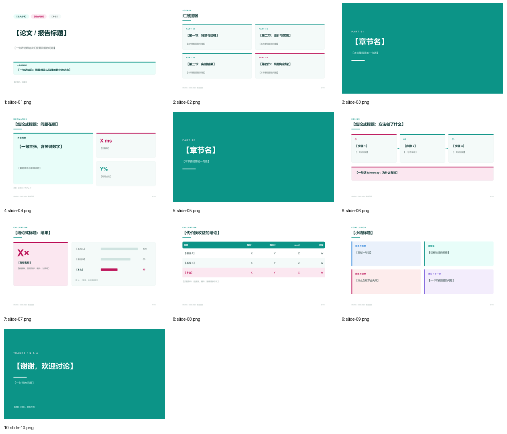

# Mosaic · Bento 卡片（青绿＋品红）

> 蒸馏自 `sci-brain-slides 0.1.0` vibrant 主题 / `cards` / `callouts` / `band` 布局（Typst Universe，2026-09 发布），并参考 ACL 2025 示例的彩色高亮 callout 与满版分区页。只保留风格。来源、色值与截图见 [`refs/ATTRIBUTION.md`](refs/ATTRIBUTION.md)。

**适合**：内容点很多、需要把结论拆成块的论文精读 / 文献综述 / 中期汇报；想让页面看起来"当代"而不是"模板"。
**不适合**：追求极简留白、或只想讲清一件事的短 talk。

## 视觉签名

**圆角卡片网格（Bento）**是基本单元：1 大卡 + 2 小卡、2×2 等分、三卡横排；每张卡有 0.06 in 青绿顶边。**四种低饱和 callout**（浅蓝背景 / 浅绿已验证 / 浅红局限 / 浅紫结论）各带左侧竖条。**满版青绿章节页与致谢页**。全扁平：无渐变、无阴影、无 3D。

和 Band Grid 的区别：Band Grid 是"横向标签带"（线性、规整、偏正式），Mosaic 是"卡片网格"（块状、可重组、偏当代）；前者用橙收口，后者用品红收口。

## 字体与基础模板

西文 Arial / Helvetica（Arimo），中文 Microsoft YaHei（Noto Sans SC），等宽 Consolas。

| token | 值 (pt) | 用在哪 |
|---|---:|---|
| `cover` | 38 | 封面标题 |
| `bigNumber` | 58 | 结果页唯一大数字（品红） |
| `section` | 44 | 满版青绿章节页 |
| `title` | 23 | 内容页标题 |
| `body` | 16 | 卡片正文 |
| `subtitle` / `cardTitle` / `small` | 15 / 15 / 12.5 | 副标题 / 卡片标题 / 说明 |
| `caption` / `kicker` / `footer` | 10.5 / 10 / 8.5 | 图注 / 页首标签 / 页脚 |

- 检查本机字体：`python scripts/check_fonts.py mosaic`；来源、授权与安全字体组见 [fonts.md](../../references/fonts.md)。
- 基础模板：[template.pptx](template.pptx)（每页是带占位说明的原型，演讲备注写明这页该放什么），预览：

## 配色（实测自 `sci-gallery.pdf` p7）

| token | 值 | 语义 |
|---|---|---|
| `primary` | `#0C9487` | 青绿：卡片顶边、表头、满版章节页、自绘图主模块 |
| `primaryDark` / `primarySoft` | `#124E49` / `#E8FDF9` | 深青绿 / 浅薄荷承托面 |
| `accent` / `accentSoft` | `#BE175C` / `#FBE7F0` | **品红：只给结论与本文方案**，一页最多一处 |
| `ink` / `body` / `muted` | `#123B38` / `#26423F` / `#5A6B69` | 标题 / 正文 / 说明 |
| `frame` / `rule` / `ghost` | `#F4FAF9` / `#DCEAE7` / `#CFE3E0` | 卡片面 / 细边 / 非重点条 |
| `calloutContext` / `calloutVerified` / `calloutLimit` / `calloutTakeaway` | `#EAF1FB` / `#E8FDF9` / `#FDECEC` / `#F3EDFC` | 背景 / 已验证 / 局限 / 结论四种浅底 |

## 栅格

| token | 值 (in) | 说明 |
|---|---:|---|
| `marginX` | 0.78 | 左右边距 |
| `contentY` / `contentBottom` | 1.62 / 6.72 | 内容安全区（无页眉带） |
| `gutter` | 0.28 | **卡片间距**，所有网格共用 |
| `cardRadius` | 0.10 | 圆角上限 |
| `footerY` | 7.00 | 页脚 |

页首无通栏带：小号青绿 kicker → 标题 → 0.7 in 青绿短横线。

## 页面原型（`prototypes.js`）

| type | 用途 | 关键字段 |
|---|---|---|
| `cover` | 三个彩色 chip + 结论卡 | `chip1/2/3, title, subtitle, takeaway, meta` |
| `outline` | 2×2 Bento 卡 | `items[{t,note}]` |
| `section` | **满版青绿**分区页 | `index, title, note` |
| `claim` | 1 大卡 + 2–3 小卡（3 个时自动收缩，不丢数字） | `claim, claimNote, metrics[{v,k,hot}], source` |
| `method` | 三张顶边卡 + 品红 takeaway 条 | `stages[{t,d}], hot, takeaway` |
| `result` | 品红大数字卡 + 横条卡 | `big, bigLabel, bigNote, data[], caption` |
| `table` | 青绿满填表头 + 隔行 + 本文浅粉行 | `cols, widths, rows[{cells,ours}], tableNote` |
| `summary` | **四色 callout** 2×2 | `cards[{label,text}]` |
| `thanks` | 满版青绿致谢 | `title, line, contact` |

工具：`head / foot / card / chip / hbars`。

## 推荐页序（10 页）

`cover → outline → section① → claim → section② → method → result → table → summary → thanks`

**三页满版青绿**（3 / 5 / 10）把节奏切成三段；中间的内容页靠卡片网格保持密度感。若删掉分区页，整份 deck 会变成一堆散卡片。

## 硬约束

1. 卡片间距统一 0.28 in，圆角 ≤0.10 in；**禁止**渐变、阴影、3D、描边发光。
2. 一页最多 4 张卡；卡片顶边只有青绿或品红两种，不要出现第三种颜色。
3. 品红 `accent` 一页最多一处（结论、本文方案或当前阶段），不要同时给大数字和卡片顶边。
4. callout 是「浅底 + 左侧 0.065 in 竖条 + 加粗标签」，**不是**把整段文字上色；四种语义固定，不要混用。
5. 图表：横向条形，对照 `ghost` 灰青、本文品红；无网格线、无图例框，数值直接标在条尾。
6. 表格：青绿满填表头白字、隔行浅底、无竖线、数字列右对齐；本文行浅粉底 + 品红字加粗。
7. 数字页写清来源；图注「图 N：说明看哪里」与正文引用编号一致。
8. 一页最多 3 条要点，每条中文 ≤30 字；卡片里超两行就拆卡，不要缩字号。

## 文件与验证

`tokens.json`、`prototypes.js`（9 原型，PPTX/SVG 双画布可用）、`template.pptx`（10 页填空 + 演讲备注）、`samples/`（`npm run samples` 生成）、`refs/`、`template-preview/`。

`check_deck.py` → `pass`；以本套 token 重载 `lint_style` → 0 errors / 0 warnings；`npm run samples` 同时产出每页 SVG 预览；渲染后逐页视觉迭代 2 轮（[`samples/overview.png`](samples/overview.png)）。
