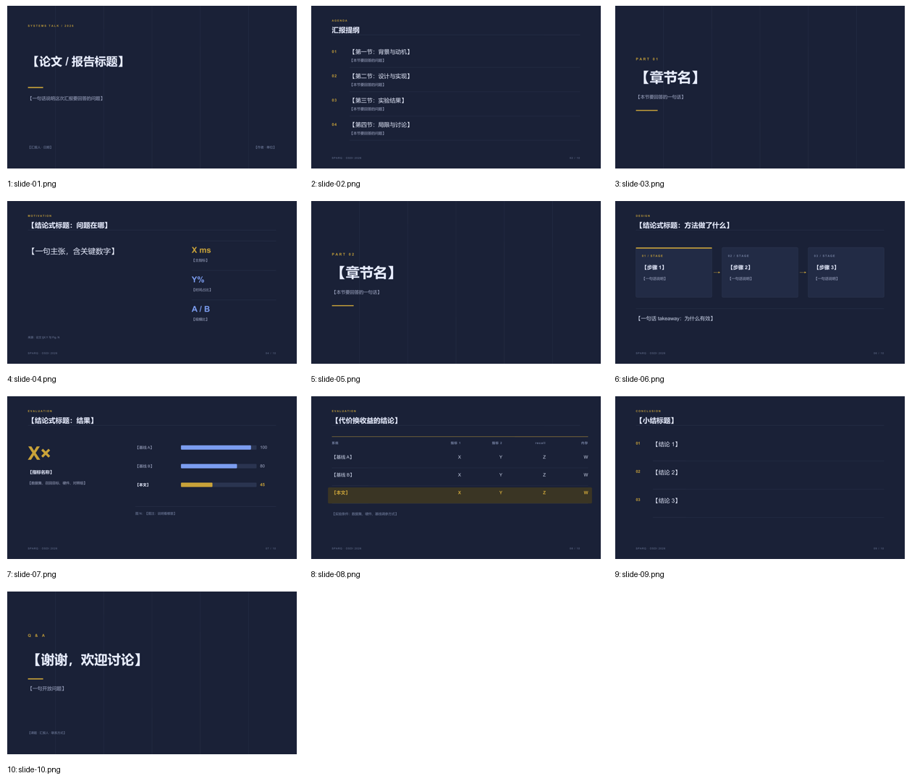

# Nocturne · 深色石板与暖金

> 蒸馏自 `sci-brain-slides 0.1.0` dark 主题色板（p5）与 gallery 满版深色结论页（Typst Universe，2026-09 发布）；交叉验证 Neversink 深色 intro 页。只保留风格。来源、色值与截图见 [`refs/ATTRIBUTION.md`](refs/ATTRIBUTION.md)。

**适合**：晚间组会、技术深潜、系统与性能类论文、投影环境较暗的场合。
**不适合**：需要打印、强光教室、或必须放大量细小表格的汇报。

## 视觉签名

**全稿深色**（不是"部分深色页"）+ **暖金唯一强调** + **淡蓝次级数据** + 0.5 pt 发丝线与等宽小标签 + 极淡竖网格线（只在封面 / 章节 / 致谢）。没有阴影、没有发光、没有霓虹、没有渐变。

和 Graphite 的区别：Graphite 只有 30% 深色页且强调色是红；Nocturne 十页全深，强调色是低饱和暖金，数据用淡蓝而不是灰。

## 字体与基础模板

西文 Arial / Helvetica（Arimo），中文 Microsoft YaHei（Noto Sans SC），等宽 Consolas / JetBrains Mono。页首 kicker 用等宽感的大字距英文标签，中文长句不要放进 kicker（会被 lint 判为超长强调 run）。

| token | 值 (pt) | 用在哪 |
|---|---:|---|
| `cover` | 38 | 封面标题 |
| `bigNumber` | 62 | 结果页唯一大数字（金色） |
| `section` | 46 | 章节页 |
| `title` | 23 | 内容页标题 |
| `body` | 16 | 正文 |
| `subtitle` / `cardTitle` / `small` | 15 / 14 / 12.5 | 副标题 / 卡片标题 / 说明 |
| `caption` / `kicker` / `footer` | 10.5 / 9 / 8 | 图注 / 等宽标签 / 页脚 |

- 检查本机字体：`python scripts/check_fonts.py nocturne`；来源、授权与安全字体组见 [fonts.md](../../references/fonts.md)。
- 基础模板：[template.pptx](template.pptx)（每页是带占位说明的原型，演讲备注写明这页该放什么），预览：

## 配色（实测自 `sci-gallery.pdf` p5）

| token | 值 | 语义 |
|---|---|---|
| `bg` | `#1A2137` | 石板底（实测占该页 32.6%） |
| `ink` / `body` | `#E7ECFE` / `#CBD3E8` | 标题 / 正文（**不用纯白**，降低眩光） |
| `muted` / `faint` | `#A5ADCA` / `#7885A6` | 说明 / 页脚 |
| `accent` | `#C7A139` | **暖金：全稿唯一强调**，关键数字、当前阶段、结论 |
| `cool` | `#7B9CEF` | 淡蓝：次级信息、非重点数据条 |
| `surface` / `surfaceAlt` | `#222B45` / `#2A3450` | 卡片面 / 条形槽底 |
| `rule` / `ghost` | `#39435F` / `#3A4463` | 发丝线 / 网格线 |
| `accentSoft` | `#3A3524` | 本文行的暗金底 |

## 栅格

| token | 值 (in) | 说明 |
|---|---:|---|
| `marginX` | 0.95 | 左右边距 |
| `kickerY` / `ruleY` | 0.60 / 1.34 | 等宽标签 / 标题下发丝线 |
| `contentY` / `contentBottom` | 1.80 / 6.70 | 内容安全区 |
| `footerY` | 7.02 | 页脚（无横线，靠颜色区分） |
| `gutter` | 0.40 | 卡片间距 |

## 页面原型（`prototypes.js`）

| type | 用途 | 关键字段 |
|---|---|---|
| `cover` | 深底 + 等宽标签 + 金色短线 | `kicker, title, subtitle, meta, authors` |
| `outline` | 金色序号 + 发丝线列表 | `items[{t,note}]` |
| `section` | 深底 + 淡竖网格 + PART + 金色短线 | `index, title, note` |
| `claim` | 左侧主张 + 右侧三行数据 | `claim, metrics[{v,k,hot}], source` |
| `method` | 三张 `surface` 卡 + 金色箭头 | `stages[{t,d}], hot, takeaway` |
| `result` | 金色大数字 + 淡蓝/金横条 | `big, bigLabel, bigNote, data[], caption` |
| `table` | 深底横线表，本文行暗金底 | `cols, widths, rows[{cells,ours}], tableNote` |
| `summary` | 三行金色序号结论 | `items[]` |
| `thanks` | 深底 + 深竖网格 + Q & A | `title, line, contact` |

工具：`head / foot / card / hbars / grid`。

## 推荐页序（10 页）

`cover → outline → section① → claim → section② → method → result → table → summary → thanks`

十页全深，节奏靠**发丝线、网格与金色出现的位置**制造：封面 / 章节 / 致谢有网格，内容页没有；金色只在关键数字、当前阶段和短线上出现。

## 硬约束

1. **全稿深色**，任何一页都不要翻白；正文用 `#CBD3E8` 而非纯白。
2. 全稿只有一个强调色（暖金）；一页最多一个金色关键词（≤6 汉字）。淡蓝是次级数据色，不算强调。
3. kicker 用短英文等宽标签（如 `SYSTEMS TALK / 2026`），不要写长中文。
4. 用 0.5 pt 发丝线与大字距小标签分层；**禁止**阴影、发光、霓虹、渐变、3D。
5. 卡片用 `surface` 亮一档 + 0.5 pt 细边，圆角 ≤0.06 in；一页最多 3 张，只有当前阶段加金色顶条。
6. 图表：横向条形，对照淡蓝 `cool`、本文金色 `accent`；无网格线、无图例框，数值直接标在条尾。
7. 表格：只保留横线与暗金本文行；表下写实验条件。
8. 一页最多 3 条要点，每条中文 ≤26 字；深色底上字号不要低于 12 pt。

## 文件与验证

`tokens.json`、`prototypes.js`（9 原型，PPTX/SVG 双画布可用）、`template.pptx`（10 页填空 + 演讲备注）、`samples/`（`npm run samples` 生成）、`refs/`、`template-preview/`。

`check_deck.py` → `pass`；以本套 token 重载 `lint_style` → 0 errors / 0 warnings（封面 kicker 已改为短英文标签，避免超长强调 run）；`npm run samples` 同时产出每页 SVG 预览；渲染后逐页视觉迭代 2 轮（[`samples/overview.png`](samples/overview.png)）。
