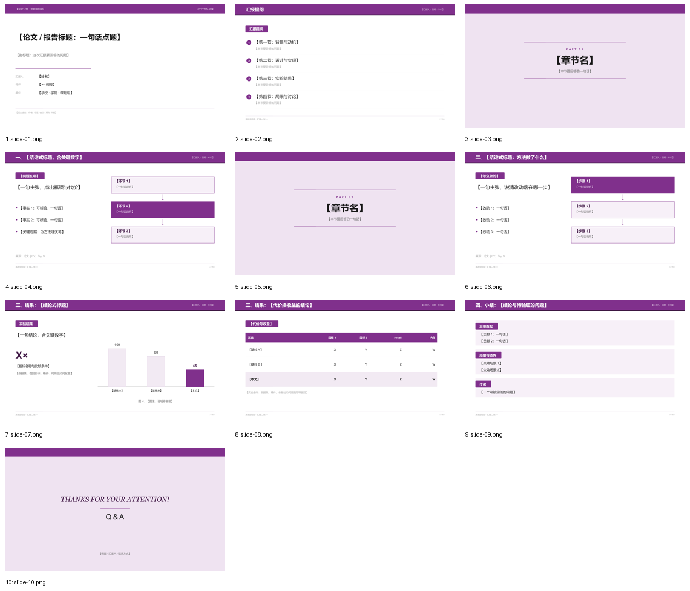

# Violet · 国内组会 / 中期（学院模板系）

> 蒸馏自清华大学 thubeamer 公开示例（`YangLaTeX/thubeamer`，`main.pdf`）。只保留风格，不复制校徽、模板源码或内容。来源、色值与逐张截图见 [`refs/ATTRIBUTION.md`](refs/ATTRIBUTION.md)。

**适合**：国内组会汇报、中期 / 开题 / 答辩、需要稳定导航与正式页眉的中文报告。
**不适合**：英文会议 talk、追求极简留白或深色科技感的场合。

## 视觉签名

每页顶部一条**满版紫色页眉带**（左标题 / 右「汇报人 · 日期 · 页码」），下沿 0.05in 深紫细线；正文用**紫底白字块标题条**分段，块宽随文字伸缩；图注居中写「图 N：…」；章节页是淡紫满版 + 居中 `PART NN` + 上下两根紫细线。全稿零深色页。

**块标题条是这套风格最强的识别符号**——它用来分行文，不是装饰，一页最多两条。

## 字体与基础模板

| 角色 | 首选 | 开源替代 |
|---|---|---|
| 西文 | Arial / Helvetica | Arimo |
| 中文 | Microsoft YaHei / PingFang SC / Source Han Sans SC | Noto Sans SC |
| 致谢页衬线 | Georgia / Times New Roman | Source Han Serif SC |
| 等宽 | Consolas / Menlo | JetBrains Mono |

层级靠字重与色块区分，**不靠第二个颜色**：页眉带内用白字 + 淡紫元信息，块标题白字，正文近黑。

- 检查本机字体：`python scripts/check_fonts.py violet`；来源、授权与安全字体组见 [fonts.md](../../references/fonts.md)。
- 基础模板：[template.pptx](template.pptx)（每页是带占位说明的原型，演讲备注写明这页该放什么），预览：

## 字号（pt，16:9）

| token | 值 | 用在哪 |
|---|---:|---|
| `cover` | 32 | 封面中文标题 |
| `bigNumber` | 44 | 结果页唯一大数字 |
| `section` | 40 | 章节页居中标题 |
| `title` | 20 | 页眉带标题（白字） |
| `body` | 17 | 正文 |
| `subtitle` | 15 | 封面副标题 |
| `barTitle` | 15 | 块标题条 |
| `small` | 14 | 说明 |
| `caption` | 12 | 居中图注 |
| `source` | 10 | 出处 |
| `footer` | 8.5 | 页脚 |

## 配色

| token | 值 | 语义 |
|---|---|---|
| `primary` | `#80308C` | 页眉带、块标题条、目录序号、自绘图主模块 |
| `primaryDark` / `accent` | `#401845` | 强调关键词、结论数字、页眉下沿细线（两者同值，保证只有一个强调色） |
| `primaryLight` | `#F2EAF3` | 内容面板、表格隔行、非重点柱 |
| `sectionBg` | `#EFE3F1` | 章节 / 致谢满版底色（原件更淡，为缩略图可辨而加深） |
| `frame` | `#F7F0F8` | 论文原图承托框 |
| `rule` / `faint` | `#D9C9DD` / `#A6A6A6` | 分隔线 / 页脚 |
| `onPrimary` | `#FFFFFF` | 主色块上的文字 |

来源实测：thubeamer p1 `#80308C`(12.7%)、`#401845`(2.0%)；p5 `#F2EAF3`(27.6%)。三个主色均为直接取样。

## 栅格

| token | 值 (in) | 说明 |
|---|---:|---|
| `marginX` | 0.62 | 窄边距，页眉带通栏 |
| `barH` | 0.62 | 页眉带高度；下沿另加 0.05 深紫线 |
| `contentY` / `contentBottom` | 1.32 / 6.72 | 内容安全区 |
| `gutter` | 0.34 | 两栏间距 |
| `footerY` | 6.98 | 页脚细线在其上 0.18 |

`twoCol` 默认左栏占 46%，左文右图；右侧三段纵向流程是本预设唯一自绘图语汇（实心 / 描边方块 + 箭头）。

## 页面原型（`prototypes.js`）

| type | 用途 | 关键字段 |
|---|---|---|
| `cover` | 白底 + 细紫带头 + 三行元信息 | `kicker, date, title, subtitle, meta[{k,v}], foot` |
| `outline` | ①②③ 徽章 + 块标题「汇报提纲」 | `items[{t,note}]` |
| `section` | 淡紫满版章节页 | `index, title, note` |
| `twoCol` | 左主张 + 要点，右三段流程 | `blockLabel, claim, bullets[], stages[{t,d}], hot, note` |
| `result` | 大数字 + 淡紫柱状图 | `claim, big, bigLabel, bigNote, data[], caption` |
| `table` | 满填紫表头 + 淡紫隔行 | `blockLabel, cols, widths, rows[{cells,ours}], tableNote` |
| `summary` | 2–3 个分块面板（贡献 / 局限 / 讨论） | `blocks[{label,items[]}]` |
| `thanks` | 淡紫致谢 + 衬线斜体 THANKS | `contact` |

工具函数：`head / foot / block / badge / dots / bars`。

## 推荐页序（10 页）

`cover → outline → section① → twoCol(问题) → section② → twoCol(方法) → result → table → summary → thanks`

节奏靠**页眉带 + 分区页**制造，因此章节页必须保留 `PART NN` 与上下细线，不能简化成一行字。每节结束建议回到 `outline` 标进度。

## 硬约束

1. 每页都要有满版页眉带；**页眉带是结构，不计入强调色预算**。
2. 一页最多 **2 个块标题条**，宽度随文字伸缩，左右内边距 0.22in。
3. 一页最多 **4 条**要点，每条中文 ≤ 30 字；`twoCol` 的每条要点尽量不换第二行（超一行就拆页）。
4. 全稿只有一个强调色 `primaryDark`；红色 / 橙色等第三方色一律不用。
5. 图注居中于图下方，格式「图 N：说明」，编号与正文引用一致；论文原图放进 `frame` 承托框。
6. 表格：满填紫表头白字、隔行 `primaryLight`、无竖线、数字列右对齐，本文行整行淡紫 + 加粗。
7. 数字页必须在左下写「来源：论文 §X.Y，Fig. N」；表下写实验条件与基线调参方式。
8. 去掉原件的校徽、立体阴影与上下双页脚带；不要重新加回来。

## 文件

| 文件 | 说明 |
|---|---|
| `tokens.json` | `loadTokens('violet')` 读取 |
| `prototypes.js` | 9 个原型 + 工具函数，PPTX / SVG 双画布可用 |
| `template.pptx` | 10 页填空模板，演讲备注写每页的内容契约 |
| `samples/` | 10 页样稿 PNG（`npm run samples` 生成，虚构占位论文） |
| `refs/` | 4 张来源截图 + 出处 |

## 验证

`check_deck.py` → `pass` / 0 errors；`lint_style.py`（以本套 token 重载）→ 0 errors / 0 warnings；`npm run samples` 同时产出每页 SVG 预览；渲染后逐页视觉迭代 5 轮（[`samples/overview.png`](samples/overview.png)）。
